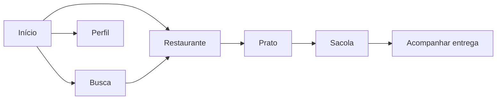
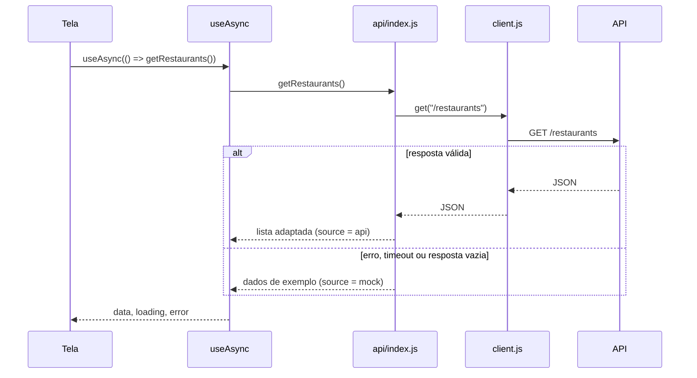
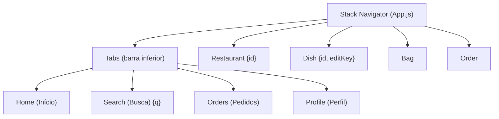

# 🔥 Brasa Delivery

Protótipo de aplicativo de delivery de comida feito com **React Native + Expo**, que consome dados da API
[`apifakedelivery.vercel.app`](https://apifakedelivery.vercel.app) e segue um layout prototipado no **Figma**.

> Trabalho acadêmico com quatro etapas: **prototipação (Figma)** → **front-end (telas)** → **consumo de dados por API** → **apresentação**.

**Autor(es):** _preencher com nome(s)_ · **Disciplina/Turma:** _preencher_

---

## Sumário

1. [Funcionalidades](#1-funcionalidades)
2. [Tecnologias](#2-tecnologias)
3. [Prototipação no Figma](#3-prototipação-no-figma)
4. [Rotas da API](#4-rotas-da-api)
5. [Como rodar o projeto](#5-como-rodar-o-projeto)
6. [Passo a passo da criação](#6-passo-a-passo-da-criação)
7. [Estrutura de pastas](#7-estrutura-de-pastas)
8. [Como o código funciona](#8-como-o-código-funciona)
9. [Regras de negócio](#9-regras-de-negócio)
10. [Decisões de projeto](#10-decisões-de-projeto)
11. [Limitações conhecidas e próximos passos](#11-limitações-conhecidas-e-próximos-passos)
12. [Solução de problemas](#12-solução-de-problemas)

---

## 1. Funcionalidades

- **Início:** saudação com o nome do usuário (muda conforme o horário), endereço de entrega, categorias, banner promocional e um restaurante em destaque.
- **Busca:** busca por texto (ignora acentos e maiúsculas), abas **Restaurantes** e **Pratos**, filtros "Até 40 min" e "Entrega grátis" e ordenação (relevância, melhor nota, mais rápido, mais perto).
- **Restaurante:** capa, avaliação, tempo e taxa de entrega, cupom e cardápio dividido em categorias.
- **Prato ("Monte seu combo"):** opções obrigatórias (ponto da carne, bebida), adicionais opcionais, observação, quantidade e preço calculado em tempo real.
- **Sacola:** edição de itens, endereço, forma de pagamento, cupom aplicado automaticamente e resumo do pedido.
- **Acompanhar entrega:** linha do tempo do pedido, mapa com a rota, entregador e janela de entrega.
- **Perfil:** dados do usuário e troca de conta (usa a lista de usuários da API).
- **Favoritos** nos restaurantes e **modo demonstração** quando a API não responde.

---

## 2. Tecnologias

| Tecnologia | Versão | Para que serve |
|---|---|---|
| [Expo](https://expo.dev) | ~58.0.20 | Ambiente que facilita criar, rodar (Expo Go) e empacotar o app |
| [React Native](https://reactnative.dev) | 0.88.0 | Interface nativa em Android e iOS com JavaScript |
| [React](https://react.dev) | 19.3.0 | Componentes, estado e hooks |
| [React Navigation](https://reactnavigation.org) | 7.x | Navegação por abas (`bottom-tabs`) e pilha (`native-stack`) |
| [react-native-svg](https://github.com/software-mansion/react-native-svg) | 15.16.0 | Desenho do mapa da tela de acompanhamento |
| [@expo/vector-icons](https://icons.expo.fyi) | ^15.0.2 | Ícones (Feather e Material Community) |
| [Plus Jakarta Sans](https://fonts.google.com/specimen/Plus+Jakarta+Sans) | `@expo-google-fonts` ^0.4.2 | Fonte do app |
| `react-native-screens` / `react-native-safe-area-context` | ~4.30.0 / ~5.10.1 | Dependências exigidas pelo React Navigation |

**API:** `https://apifakedelivery.vercel.app` (rotas `/users`, `/restaurants` e `/foods`).
Não há biblioteca de estado nem de requisições: o app usa `fetch`, `Context API` e hooks do próprio React.

---

## 3. Prototipação no Figma

O layout foi prototipado no Figma
([link do projeto](https://www.figma.com/design/2TQ02nlQ655jV1oBLXz9EV/Untitled?node-id=0-1&m=dev&t=DHzf1puD5Ait4Sw2-1))
com **6 telas** (402 px de largura, formato de celular). As imagens exportadas estão em [`docs/design`](docs/design).

| Início | Busca | Restaurante |
|:--:|:--:|:--:|
|  |  |  |

| Prato | Sacola | Acompanhar entrega |
|:--:|:--:|:--:|
|  |  |  |

**Identidade visual extraída do design** (definida em `src/theme.js`):

| Uso | Cor |
|---|---|
| Vermelho principal (botões, destaques) | `#ea1d2c` |
| Texto | `#242424` |
| Texto secundário | `#757575` |
| Linhas e bordas | `#e6e6e6` |
| Fundo de campos | `#f4f4f4` |
| Aviso / "Boa comida, bem pertinho" | `#fff4de` |
| Cupom do restaurante | `#fff0f1` |
| Sucesso (cupom aplicado, Pix) | `#1e7a3c` sobre `#edf8f0` |
| Avaliação (estrela) | `#b47813` |

A fonte usada é a **Plus Jakarta Sans** (pesos 400 a 800).

---

## 4. Rotas da API

Base: `https://apifakedelivery.vercel.app`

| Rota | Função em `src/api/index.js` | Onde é usada no app |
|---|---|---|
| `GET /users` | `getUsers()` | Perfil → lista de contas para trocar de usuário |
| `GET /users/:id` | `getUser(id)` | Início (nome e endereço), Sacola (endereço), Perfil |
| `GET /restaurants` | `getRestaurants()` | Início e Busca (aba Restaurantes) |
| `GET /restaurants/:id` | `getRestaurant(id)` | Tela do Restaurante, Prato e Sacola (taxa, cupom) |
| `GET /foods` | `getFoods()` | Busca (aba Pratos) e cardápio do restaurante |
| `GET /foods/:id` | `getFood(id)` | Tela do Prato |

> **A API não possui rota de pedidos.** Por isso, ao finalizar a compra, o pedido é criado e acompanhado **dentro do próprio app** (simulação por tempo — veja [Acompanhar entrega](#tela-acompanhar-entrega-orderscreenjs)).

### Formato dos dados

Cada tela trabalha com um formato interno padronizado. O arquivo `src/api/adapters.js` converte a resposta da API para esse formato
(aceitando nomes de campo em inglês e português, como `name`/`nome` e `price`/`preco`):

```js
// usuário
{ id, name, email, phone, address, avatar }

// restaurante
{ id, name, logo, category, description, rating, reviews, distance, time, timeMax,
  fee, free, minOrder, open, promo, badge, image, coupon }

// prato
{ id, name, description, longDescription, price, category, restaurantId,
  image, tag, includes, groups }
```

Se a API usar nomes de campo diferentes dos previstos, **basta ajustar as listas de chaves em `adapters.js`** (não é preciso mexer nas telas).
Campos ausentes recebem valores padrão para o app não quebrar.

---

## 5. Como rodar o projeto

### Pré-requisitos

- [Node.js](https://nodejs.org) (versão LTS; o projeto foi verificado com a 22) e npm
- App **Expo Go** instalado no celular ([Android](https://play.google.com/store/apps/details?id=host.exp.exponent) / [iOS](https://apps.apple.com/app/expo-go/id982107779)) **ou** um emulador Android/iOS
- Celular e computador **na mesma rede Wi-Fi**

### Passos

```bash
# 1. Clonar o repositório
git clone https://github.com/<seu-usuario>/<seu-repositorio>.git
cd <seu-repositorio>

# 2. Instalar as dependências
npm install

# 3. Iniciar o servidor de desenvolvimento
npx expo start
```

Depois de iniciar, **escaneie o QR code** que aparece no terminal:

- **Android:** abra o Expo Go e use "Scan QR code".
- **iOS:** abra a câmera do iPhone e toque no link do Expo Go.
- **Emulador:** com o servidor aberto, pressione `a` (Android) ou `i` (iOS, somente macOS).

### Scripts

| Comando | O que faz |
|---|---|
| `npm start` | Mesmo que `npx expo start` |
| `npm run android` | Inicia e abre no emulador/dispositivo Android |
| `npm run ios` | Inicia e abre no simulador iOS (macOS) |
| `npx expo start --clear` | Inicia limpando o cache do Metro (use ao ver erros estranhos) |

> ⚠️ O comando é **`npx`** (com **x**), e não `npm expo`.

---

## 6. Passo a passo da criação

Esta seção descreve, na ordem em que foi feito, como o projeto foi construído. Dá para seguir os passos para recriar o app do zero.

### Etapa 1 — Prototipar no Figma
1. Definir o fluxo principal do usuário: **descobrir → escolher restaurante → montar o prato → pagar → acompanhar**.
2. Desenhar as 6 telas em formato de celular (402 px).
3. Definir a paleta de cores e a tipografia (seção [3](#3-prototipação-no-figma)).
4. Exportar as telas em PNG para servir de referência durante o desenvolvimento.

### Etapa 2 — Escolher a tecnologia
O enunciado permitia React, Angular, Vue, React Native ou Expo. Foi escolhido **React Native com Expo** porque:
- gera um app de verdade (Android/iOS) com JavaScript;
- o **Expo Go** permite testar no celular sem instalar Android Studio;
- compartilha conceitos (componentes, props, estado, hooks) com o React da web.

### Etapa 3 — Criar o projeto e instalar as dependências

```bash
# cria um projeto Expo em JavaScript
npx create-expo-app@latest brasa-delivery-app --template blank
cd brasa-delivery-app

# navegação
npx expo install @react-navigation/native @react-navigation/native-stack @react-navigation/bottom-tabs
npx expo install react-native-screens react-native-safe-area-context

# gráficos, ícones, fontes e barra de status
npx expo install react-native-svg @expo/vector-icons expo-font expo-status-bar
npx expo install @expo-google-fonts/plus-jakarta-sans
```

O comando `npx expo install` escolhe automaticamente a versão de cada pacote compatível com a versão do Expo.

No `package.json`, o campo `"main"` aponta para `index.js`, que registra o componente raiz:

```js
// index.js
import { registerRootComponent } from 'expo';
import App from './App';

registerRootComponent(App);
```

> **Não crie um `babel.config.js` à mão.** O Expo já usa a configuração correta por padrão (veja [Solução de problemas](#12-solução-de-problemas)).

### Etapa 4 — Organizar as pastas
Foi adotada uma separação por responsabilidade (seção [7](#7-estrutura-de-pastas)): `api/` para dados, `context/` para estado global, `components/` para peças reutilizáveis e `screens/` para as telas.

### Etapa 5 — Criar o tema (`src/theme.js`)
Centraliza **cores** (`C`), **fontes** (`F`) e funções de formatação (`brl`, `num`, `hhmm`, `norm`, `img`). Assim, mudar uma cor ou fonte é uma alteração em um só lugar.

### Etapa 6 — Criar a camada de API (`src/api/`)
Foi construída em quatro arquivos, cada um com um papel:
1. `client.js` — faz a requisição `fetch` com limite de tempo.
2. `adapters.js` — traduz o JSON da API para o formato das telas.
3. `mock.js` — dados de exemplo com o conteúdo do Figma.
4. `index.js` — expõe as seis funções (`getUsers`, `getUser`, …) e decide entre usar a API ou os dados de exemplo.

### Etapa 7 — Estado global e hook de carregamento
- `context/AppContext.js` guarda **sacola, favoritos, pedido e usuário atual**, para que várias telas compartilhem a mesma informação.
- `hooks.js` cria o `useAsync`, que executa uma chamada de API e devolve `{ data, loading, error, reload }`.

### Etapa 8 — Componentes reutilizáveis (`components/ui.js`)
Texto com fonte padrão (`T`), ícones (`Ic`), avaliação (`Rating`), logotipo (`Logo`), botão (`Btn`), botão redondo (`Round`), contador de quantidade (`Stepper`), tela de carregamento (`Loading`), mensagens (`Message`) e o aviso de modo demonstração (`SourceNotice`).

### Etapa 9 — Construir as telas
Ordem seguida (do mais simples ao mais completo): **Início → Busca → Restaurante → Prato → Sacola → Acompanhar entrega → Perfil**.
Cada tela busca seus dados com `useAsync`, trata `loading`/`error` e só então desenha a interface.

### Etapa 10 — Configurar a navegação (`App.js`)
Carrega as fontes, envolve o app nos provedores (`SafeAreaProvider`, `AppProvider`, `NavigationContainer`) e declara as rotas (abas + pilha).

### Etapa 11 — Testar e corrigir
- A camada de API foi testada com três cenários: **sem internet**, **resposta com campos em inglês** e **erro HTTP 500**.
- O empacotamento (`bundle`) Android foi gerado com `npx expo export --platform android` para validar que tudo compila.
- Problemas encontrados no caminho e como foram resolvidos estão na seção [12](#12-solução-de-problemas).

### Etapa 12 — Publicar no GitHub

```bash
git init
git add .
git commit -m "Brasa Delivery: protótipo em React Native"
git branch -M main
git remote add origin https://github.com/<seu-usuario>/<seu-repositorio>.git
git push -u origin main
```

O arquivo `.gitignore` já impede o envio de `node_modules/` e de arquivos locais do Expo.

---

## 7. Estrutura de pastas

```
brasa-delivery-app/
├── index.js                     # registra o componente raiz do Expo
├── App.js                       # fontes, provedores e navegação
├── app.json                     # configuração do app Expo
├── package.json                 # dependências e scripts
├── .gitignore
├── assets/
│   └── img/                     # fotos usadas nos dados de exemplo
├── docs/
│   └── design/                  # telas exportadas do Figma
└── src/
    ├── theme.js                 # cores, fontes e funções de formatação
    ├── hooks.js                 # useAsync (carregamento de dados)
    ├── api/
    │   ├── client.js            # fetch com timeout
    │   ├── adapters.js          # JSON da API → formato interno
    │   ├── mock.js              # dados de exemplo
    │   └── index.js             # getUsers, getUser, getRestaurants, ...
    ├── context/
    │   └── AppContext.js        # sacola, favoritos, pedido, usuário atual
    ├── components/
    │   └── ui.js                # componentes reutilizáveis
    └── screens/
        ├── HomeScreen.js        # Início
        ├── SearchScreen.js      # Busca
        ├── RestaurantScreen.js  # Restaurante
        ├── DishScreen.js        # Prato
        ├── BagScreen.js         # Sacola
        ├── OrderScreen.js       # Acompanhar entrega + aba Pedidos
        └── ProfileScreen.js     # Perfil
```

---

## 8. Como o código funciona

### 8.1 Visão geral



Fluxo de dados de qualquer tela:



### 8.2 Ponto de entrada: `index.js` e `App.js`

- **`index.js`** chama `registerRootComponent(App)`, que diz ao Expo qual é o componente raiz.
- **`App.js`** faz três coisas:
  1. **Carrega as fontes** com `useFonts`. Enquanto não terminam de carregar, mostra o `Loading`.
  2. **Monta os provedores**, de fora para dentro: `SafeAreaProvider` (áreas seguras do celular) → `AppProvider` (estado global) → `NavigationContainer` (navegação).
  3. **Declara a navegação** (próxima seção).

### 8.3 Navegação

O app combina dois tipos de navegação do React Navigation:

- **Stack (pilha):** telas que "empilham" umas sobre as outras e têm botão de voltar.
- **Tabs (abas):** a barra inferior com Início, Busca, Pedidos e Perfil.



| Rota | Parâmetros | Como chegar |
|---|---|---|
| `Search` | `q` (texto da busca, opcional) | Aba Busca, campo de busca ou categoria da Início |
| `Restaurant` | `id` | Card ou item da lista de restaurantes |
| `Dish` | `id`, `editKey` (opcional) | Item do cardápio; `editKey` é enviado pelo botão **Editar** da sacola |
| `Bag` | — | Botão "Ver sacola" ou ao adicionar um prato |
| `Order` | — | Ao finalizar o pedido |

Os parâmetros são lidos com `route.params` e a navegação é feita com `navigation.navigate('Restaurant', { id: r.id })`.

### 8.4 Tema (`src/theme.js`)

| Export | Função |
|---|---|
| `C` | Cores do design |
| `F` | Nomes das fontes por peso (`r`, `m`, `sb`, `b`, `xb`) |
| `brl(n)` | Formata dinheiro: `39.9` → `R$ 39,90` |
| `num(n)` | Troca ponto por vírgula: `4.9` → `4,9` |
| `hhmm(ms)` | Converte um instante em `HH:MM` |
| `norm(s)` | Remove acentos e deixa minúsculo (usado na busca) |
| `img(src)` | Aceita **URL** (vinda da API) ou **imagem local** (`require`) e devolve a fonte certa para o componente `Image` |

A formatação de moeda é feita **à mão** (sem `Intl`), porque o suporte a `Intl` varia entre dispositivos Android.

### 8.5 Camada de API (`src/api/`)

#### `client.js` — requisição com limite de tempo

```js
export const BASE_URL = 'https://apifakedelivery.vercel.app';

export async function get(path) {
  const ctl = new AbortController();
  const timer = setTimeout(() => ctl.abort(), 8000);   // cancela após 8 segundos
  try {
    const res = await fetch(BASE_URL + path, { signal: ctl.signal });
    if (!res.ok) throw new Error('HTTP ' + res.status); // 404, 500...
    return await res.json();
  } finally {
    clearTimeout(timer);
  }
}
```

#### `adapters.js` — traduz o JSON da API

A API pode devolver uma lista direta (`[...]`) ou embrulhada (`{ data: [...] }`), e um item como objeto ou como lista de 1 elemento. Duas funções cobrem isso:

```js
export const list = (d) => (Array.isArray(d) ? d : pick(d, ['data', 'items', 'results', 'users', 'restaurants', 'foods'], []));
export const one  = (d) => (Array.isArray(d) ? d[0] : pick(d, ['data', 'result'], d));
```

`pick(obj, ['name', 'nome', 'title'], padrão)` devolve o **primeiro campo existente** da lista. É assim que o adaptador aceita nomes em inglês e português. As funções `user()`, `restaurant()` e `food()` montam o formato interno de cada entidade, convertendo preços como `"39,90"` em número e dando valores padrão quando falta algum campo.

#### `index.js` — decide entre API e dados de exemplo

```js
async function load(path, adapt, fallback) {
  try {
    const value = adapt(await get(path));
    if (value && (!Array.isArray(value) || value.length)) { status.source = 'api'; return value; }
    throw new Error('resposta vazia ou em formato inesperado');
  } catch (e) {
    console.warn(`[API] ${path}: ${e.message} → usando dados de exemplo`);
    status.source = 'mock';
    return fallback();
  }
}

export const getRestaurants = () => load('/restaurants', (d) => A.list(d).map(A.restaurant).filter(Boolean), () => mock.restaurants);
```

- Se a requisição funciona, o app usa os **dados reais** e marca `status.source = 'api'`.
- Se falha (sem internet, timeout, erro HTTP, resposta vazia ou inesperada), usa os **dados de exemplo** de `mock.js` e marca `status.source = 'mock'`.
- Quando `status.source === 'mock'`, a tela Início exibe o aviso **"Modo demonstração"** (componente `SourceNotice`). Assim fica claro, durante a apresentação, se os dados são reais ou não.
- O motivo da falha aparece no terminal do Expo via `console.warn`.

As outras cinco funções (`getUsers`, `getUser`, `getRestaurant`, `getFoods`, `getFood`) seguem o mesmo padrão.

#### `mock.js` — dados de exemplo

Reproduz o conteúdo do Figma: o usuário **Marina**, 6 restaurantes (Brasa Burger, Ponto do Smash, Burger da Vila, Forno a Lenha, Tempero da Vó e Sakura Sushi) e 8 pratos, incluindo o **Combo Brasa** com seus grupos de opções (ponto da carne, bebida e adicional).

### 8.6 Hook `useAsync` (`src/hooks.js`)

```js
const { data, loading, error, reload } = useAsync(() => getRestaurants(), []);
```

Executa a função assíncrona quando a tela abre (e sempre que algo do segundo parâmetro mudar) e devolve:

| Campo | Significado |
|---|---|
| `loading` | `true` enquanto a requisição está em andamento |
| `data` | Resultado, quando termina |
| `error` | Erro, se houver |
| `reload()` | Executa a chamada de novo (botão "Tentar de novo") |

Um sinalizador interno (`alive`) evita atualizar o estado se a tela for fechada antes da resposta chegar.

Padrão usado nas telas:

```js
if (loading) return <Loading />;
if (error)   return <Message title="Não conseguimos carregar" action="Tentar de novo" onAction={reload} />;
// aqui os dados já estão disponíveis
```

### 8.7 Estado global (`src/context/AppContext.js`)

Usa a **Context API** do React para compartilhar estado entre telas sem passar props.

| Estado | O que guarda |
|---|---|
| `cart` | `{ restaurant, items[] }` — sacola atual |
| `favs` | Mapa `{ [idRestaurante]: true/false }` |
| `order` | Último pedido feito |
| `userId` | Usuário logado (começa em `'1'`) |

| Função | O que faz |
|---|---|
| `addItem(restaurant, item, editKey?)` | Adiciona um item. Com `editKey`, **substitui** o item existente. Se o restaurante for diferente do da sacola, **começa uma sacola nova** |
| `setQty(key, qty)` | Altera a quantidade; com `qty <= 0` remove o item; sacola sem itens volta ao estado vazio |
| `clearCart()` | Esvazia a sacola |
| `toggleFav(id)` | Marca/desmarca favorito |
| `placeOrder(total, address)` | Cria o pedido (id a partir de **4821**), guarda em `order` e esvazia a sacola |
| `setUserId(id)` | Troca o usuário (todas as telas recarregam seus dados) |
| `count` | Total de itens na sacola |

Cada item da sacola tem este formato:

```js
{ key, foodId, name, image, qty, unit, summary: [...], notes, selection }
//   unit = preço unitário já com os adicionais; selection = opções escolhidas por grupo
```

Para usar o estado em qualquer tela: `const { cart, addItem } = useApp();`.

### 8.8 Componentes reutilizáveis (`src/components/ui.js`)

| Componente | Função |
|---|---|
| `T` | `Text` com fonte e cor padrão do tema |
| `Ic` | Ícone por nome (`'home'`, `'bike'`, `'pin'`…), mapeado para Feather ou Material Community |
| `Rating` | Estrela + nota |
| `Logo` | Quadrado vermelho com chama e sigla do restaurante |
| `Btn` | Botão vermelho principal (aceita texto à direita, ex.: o preço) |
| `Round` | Botão circular com ícone (voltar, favoritar, ajuda…) |
| `Stepper` | Contador `− 1 +` |
| `Loading` / `Message` | Estados de carregamento, erro e vazio |
| `SourceNotice` | Aviso "Modo demonstração" |

### 8.9 As telas

#### Tela Início (`HomeScreen.js`)
- Busca `getUser(userId)` e `getRestaurants()` juntos com `Promise.all`.
- Saudação por horário: antes das 12h **Bom dia**, antes das 18h **Boa tarde**, depois **Boa noite**.
- Endereço vem do usuário da API.
- As 4 categorias (Lanches, Pizza, Brasileira, Japonesa) navegam para a Busca já com o texto preenchido (`navigate('Search', { q })`).
- O card em destaque é o **primeiro restaurante** da lista.

#### Tela Busca (`SearchScreen.js`)
- Carrega restaurantes e pratos uma vez e **filtra no próprio app**.
- Busca insensível a acentos e maiúsculas, usando `norm()` (por exemplo, "hamburguer" encontra "Hambúrguer").
- Chips: **Até 40 min** (`timeMax <= 40`) e **Entrega grátis** (`free`).
- Ordenação: Relevância (ordem da API), Melhor nota, Mais rápido e Mais perto. Tocar em "Relevância" (ou no chip **Filtros**) passa para a próxima opção.
- Se o texto for "Hambúrguer", o título vira **"Burger do seu jeito"**, como no design.
- A aba **Pratos** lista `/foods` filtrados pelo mesmo texto.
- O coração marca favoritos (`toggleFav`).

#### Tela Restaurante (`RestaurantScreen.js`)
- Busca `getRestaurant(id)` e `getFoods()` e mostra apenas os pratos cujo `restaurantId` seja o do restaurante. Se a API não trouxer esse vínculo, mostra todos os pratos.
- As abas do cardápio vêm das categorias dos pratos; **Mais pedidos** mostra os pratos em destaque (todos, a menos que o prato tenha `top: false`).
- O cupom só aparece se o restaurante tiver um (`coupon`).
- Se a sacola já tiver itens deste restaurante, aparece o botão fixo **Ver sacola**.

#### Tela Prato (`DishScreen.js`)
É dividida em duas partes: `DishScreen` (carrega `getFood(id)` e o restaurante dele) e `DishForm` (a tela em si, que guarda as escolhas).

Cada prato pode ter **grupos de opções**:

| Campo do grupo | Efeito |
|---|---|
| `type` | `'chips'` (botões lado a lado), `'radio'` (escolha única) ou `'check'` (caixa de seleção) |
| `required` | Se `true`, o botão **Adicionar** fica desabilitado até haver uma escolha |
| `max` | Máximo de opções (com `1`, escolher outra troca a seleção) |
| `options[].default` | Já vem selecionada |
| `options[].price` | Valor adicional somado ao preço |

- O preço mostrado no botão é `(preço do prato + adicionais) × quantidade`, atualizado a cada toque.
- Ao adicionar, o app monta o **resumo** exibido na sacola (ex.: "Ao ponto · Coca-Cola Zero 350 ml" e "+ Bacon crocante · Fritas 150 g").
- Se a sacola tiver itens de **outro restaurante**, aparece um alerta perguntando se deseja esvaziá-la.
- Com `editKey` (vindo do botão **Editar** da sacola), a tela abre com as escolhas anteriores e o botão vira **Salvar**.

#### Tela Sacola (`BagScreen.js`)
- Lê os itens do contexto e busca o usuário (`getUser`) para mostrar o endereço de entrega.
- O botão **−** do contador, ao chegar a zero, remove o item; o ícone de lixeira esvazia a sacola (com confirmação).
- Calcula o resumo (ver [Regras de negócio](#9-regras-de-negócio)).
- **Fazer pedido** chama `placeOrder(...)` e depois:

  ```js
  navigation.reset({ index: 1, routes: [{ name: 'Tabs' }, { name: 'Order' }] });
  ```

  O `reset` monta a pilha como *Início → Pedido*, então o botão voltar leva à Início (e não de volta à sacola já vazia).

#### Tela Acompanhar entrega (`OrderScreen.js`)
Como a API não tem rota de pedidos, o andamento é **simulado pelo tempo decorrido** desde o pedido:

```js
const THRESHOLDS = [15e3, 40e3, 180e3];   // 15 s, 40 s, 3 min
const step = THRESHOLDS.filter((t) => now - order.createdAt >= t).length;   // 0 a 3
```

| Etapa (`step`) | Tempo | Mensagem |
|---|---|---|
| 0 — Confirmado | 0 s | "Pedido recebido!" |
| 1 — Preparado | 15 s | "Tá saindo da chapa!" |
| 2 — A caminho | 40 s | "Tá chegando coisa boa!" |
| 3 — Entregue | 3 min | "Bom apetite!" |

- Um `setInterval` atualiza o relógio (`now`) a cada 2 segundos, e a tela se redesenha sozinha.
- A **janela de entrega** é `horário do pedido + 30 min` até `+ 40 min`.
- O **mapa** (`RouteMap`) usa `react-native-svg` para desenhar quarteirões, praça, ruas e a rota. Os marcadores (restaurante, casa e entregador) são `View`s posicionadas sobre o SVG; o entregador se move conforme a etapa.
- Os dados do entregador (Lucas Pereira) são fixos, pois a API não fornece entregadores.
- O botão de ajuda e o chat exibem um aviso "Em breve".

#### Aba Pedidos (`OrdersTab`, em `OrderScreen.js`)
Mostra o acompanhamento do último pedido (`OrderScreen` sem botão de voltar) ou, se ainda não houver pedido, uma mensagem com botão **Ver restaurantes**.

#### Tela Perfil (`ProfileScreen.js`)
- Mostra o usuário atual (`getUser`) e a lista de contas (`getUsers`).
- Tocar em uma conta chama `setUserId(id)`: o contexto muda e **Início, Sacola e Perfil recarregam** com os dados do novo usuário.

---

## 9. Regras de negócio

| Regra | Valor | Onde está |
|---|---|---|
| Taxa de serviço | R$ 0,99 | `BagScreen.js` (`SERVICE_FEE`) |
| Taxa de entrega | Vem do restaurante (`fee`); `0` mostra "Grátis" | API / `mock.js` |
| Cupom `BRASA5` | R$ 5 de desconto em pedidos de **R$ 30 ou mais** | `mock.js` (Brasa Burger), aplicado em `BagScreen.js` |
| Preço unitário do item | preço do prato + adicionais escolhidos | `DishScreen.js` |
| Total | `subtotal + taxa de entrega + taxa de serviço − desconto` | `BagScreen.js` |
| Janela de entrega | pedido + 30 min até + 40 min | `OrderScreen.js` |
| Numeração dos pedidos | começa em `#4821` | `AppContext.js` |

**Exemplo** (igual ao design): Combo Brasa com bacon = R$ 39,90 + R$ 5,00 = R$ 44,90 →
`44,90 + 4,99 + 0,99 − 5,00 = R$ 45,88`.

---

## 10. Decisões de projeto

- **Dados de exemplo como alternativa (`mock.js`):** o app continua funcionando sem internet ou com a API fora do ar, e avisa quando isso acontece.
- **Adaptadores separados das telas:** se a API mudar o formato, só `adapters.js` precisa mudar.
- **Context API em vez de bibliotecas de estado:** o estado é pequeno (sacola, favoritos, pedido e usuário); não justifica Redux ou similares.
- **Formatação manual de moeda e hora:** evita diferenças de `Intl` entre aparelhos.
- **Um hook (`useAsync`) para todas as chamadas:** padroniza carregamento e erro em todas as telas.
- **Sem `babel.config.js`:** o Expo já traz a configuração correta.

---

## 11. Limitações conhecidas e próximos passos

**Limitações**
- A API não tem rota de pedidos: o pedido e o acompanhamento são **simulados no app**, e o entregador é fixo.
- Sacola, favoritos e pedido ficam **em memória**: fechar o app apaga tudo.
- A autenticação não existe: o "usuário logado" é escolhido na aba Perfil.
- Os campos da API são mapeados de forma tolerante (`adapters.js`); se algum nome for diferente do previsto, ajuste ali.
- As imagens de `assets/img` foram recortadas das telas exportadas e têm baixa resolução. Itens vindos da API usam as imagens da API.
- Não há testes automatizados.
- O botão **Filtros** e o rótulo **Relevância** compartilham a mesma função (alternar a ordenação).

**Próximos passos**
- Salvar sacola e favoritos com `AsyncStorage`.
- Implementar login e cadastro.
- Criar uma rota de pedidos real (por exemplo, `POST /orders`) no back-end.
- Adicionar testes (Jest + React Native Testing Library).
- Substituir as imagens recortadas por fotos em alta resolução.

---

## 12. Solução de problemas

| Sintoma | Causa e solução |
|---|---|
| `Unknown command: "expo"` | Você digitou `npm expo start`. O correto é `npx expo start` (ou `npm start`). |
| `Cannot read properties of undefined (reading 'transformFile')` (tela vermelha no celular) | Havia um `babel.config.js` que referenciava `babel-preset-expo` sem ele estar no `package.json`, e o Metro não conseguia montar o transformador. **Apague o `babel.config.js`**, se existir, e rode `npx expo start --clear`. |
| Tela vermelha com erro estranho após mudar arquivos | Limpe o cache: `npx expo start --clear`. |
| O QR code não abre no celular | Confirme que celular e computador estão na **mesma rede Wi-Fi**. Se a rede bloquear, tente `npx expo start --tunnel`. |
| Expo Go diz que a versão do SDK é incompatível | Atualize o app **Expo Go** na loja ou rode `npx expo install --fix` para alinhar as versões dos pacotes. |
| Aparece "Modo demonstração" na Início | O app não conseguiu usar a API (sem internet, API fora do ar ou formato inesperado). Veja o `console.warn` no terminal: ele indica a rota e o motivo. |
| O cardápio mostra todos os pratos em qualquer restaurante | Os pratos da API não têm um campo ligando ao restaurante (`restaurantId`). Ajuste a lista de chaves em `adapters.js`. |
| Mudou as dependências e o app quebrou | Apague `node_modules` e rode `npm install` de novo. |

---

## Licença

_Definir (por exemplo, MIT) ou remover esta seção._
